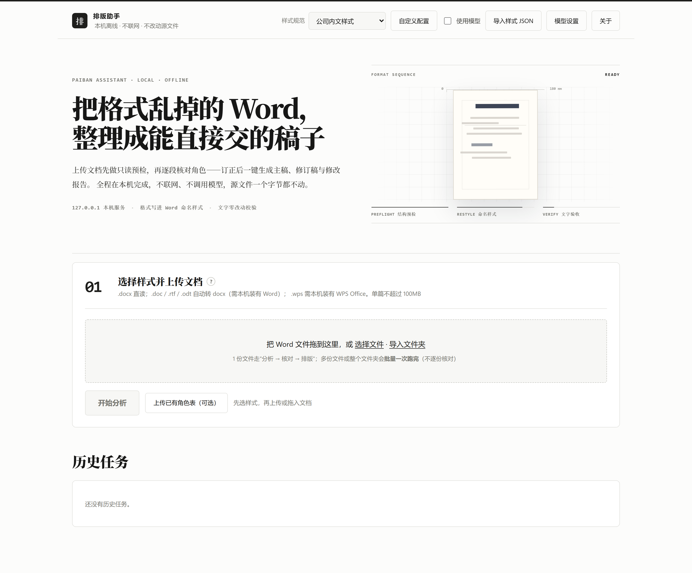
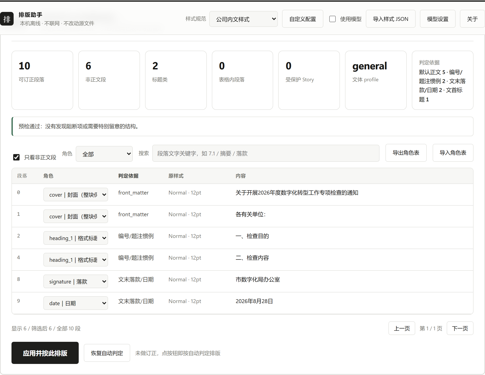
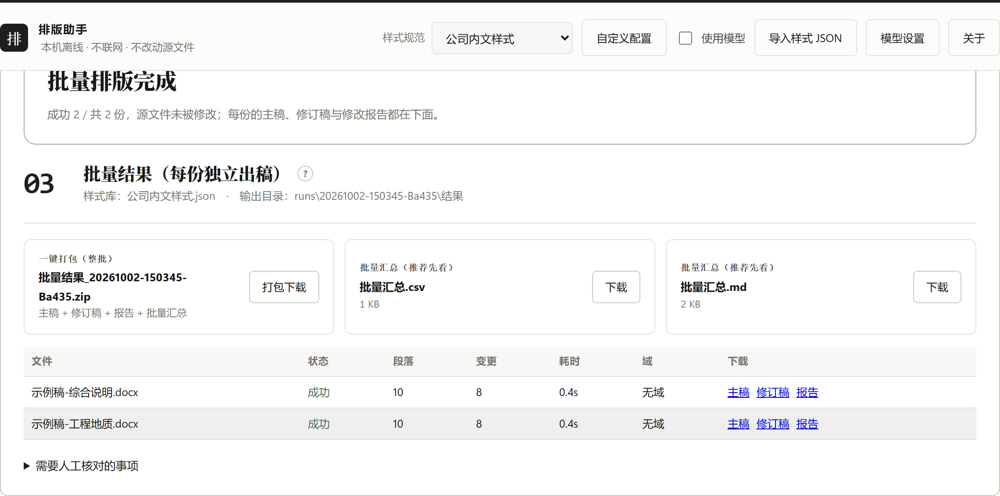
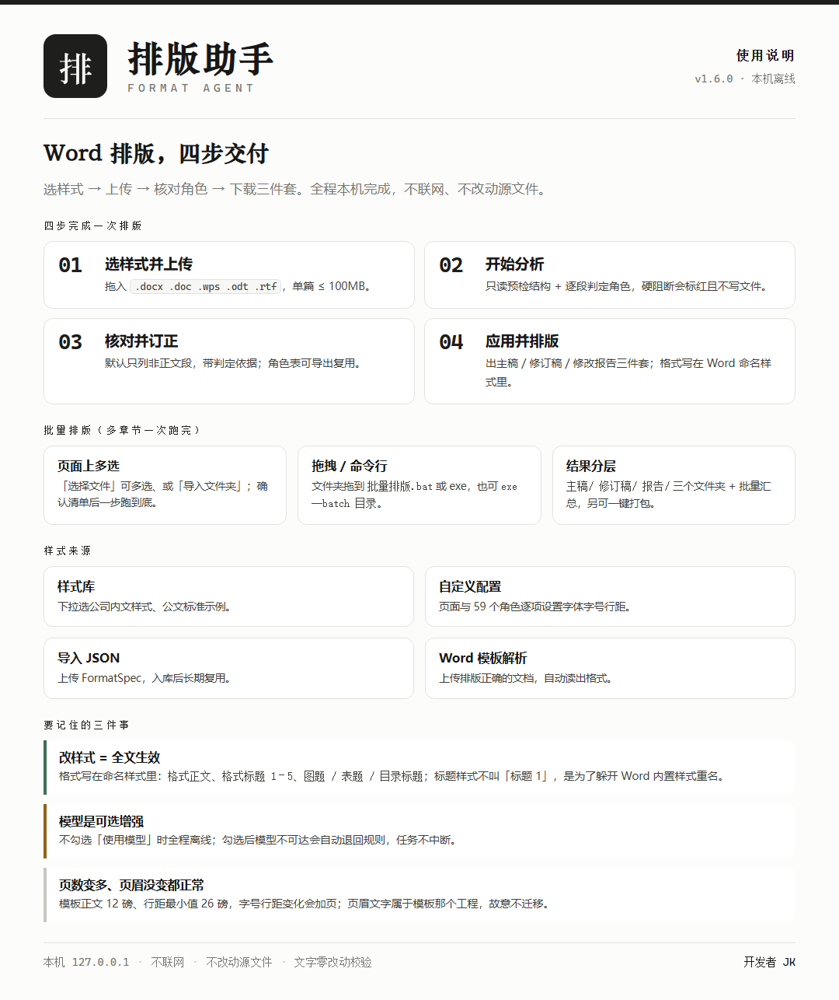
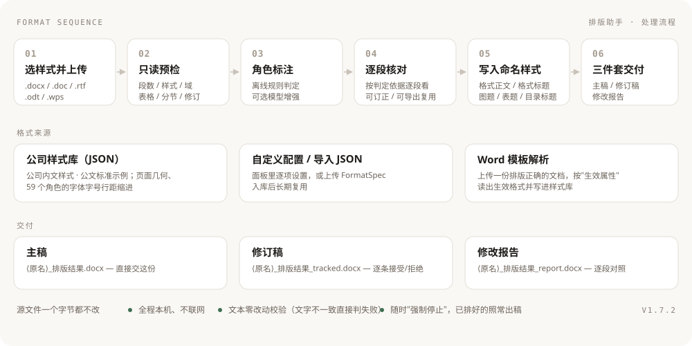

<div align="center">


### Word Format Agent · 排版助手

**把格式乱掉的 Word，整理成能直接交的稿子。**

本机离线 · 不联网 · 不改动源文件 · 格式写在 Word 命名样式里


**本仓库是项目介绍页**：只放说明、界面截图与配图。
工具源码在私有仓库，不对外分发。

</div>



---

## 它解决什么问题

- **格式乱、改起来靠手**：上传稿件先做只读预检，再逐段判定角色（标题 / 正文 / 落款 / 日期 / 题注 / 封面 / 目录…），
  点一次就把格式重排好；每段的**判定依据**（编号惯例、大纲级别、命名样式、文首文末位置）都写在段落后面的下拉里，可逐段订正。
- **格式要能"改一次、全文跟着变"**：成品不靠硬刷格式，而是写成 **Word 命名样式**——
  在样式窗格里调一次「格式正文 / 格式标题 2」，全文立刻统一。
- **交付要能审阅**：除主稿外还生成**修订稿**（带修订标记，可在 Word 审阅视图里逐条接受/拒绝）
  和**修改报告**（逐段对照，页面里能直接看）。
- **文字一个都不能动**：排版前后做**文本一致性校验**，正文与受保护 Story 文字不一致就直接判失败、不落盘。
- **多章节一次跑完**：一个报告的「封面+目录」与各章节可以整批处理，每份独立出稿、不合并、不动各章页码。
- **能停**：分析/排版跑起来后随时「强制停止」，已排好的照常出稿，任务闸门立即释放。

## 界面一览

| 核对页：统计 + 逐段判定依据 + 角色订正 |
| --- |
|  |

| 排版完成：主稿 / 修订稿 / 修改报告三件套 |
| --- |
|  |

| 批量结果：一键打包 + 汇总 + 逐份三件套 |
| --- |
|  |

## 一页纸速查



## 处理流程



1. **选样式并上传**：支持 `.docx` / `.doc` / `.rtf` / `.odt` / `.wps`（后四者用本机 Word / WPS 转档）。
2. **只读预检**：扫正文、页眉页脚、脚注、文本框、表格、分节、域与修订，给出"只保留、不重排"的结构清单。
3. **角色标注**：默认**离线规则**（编号/题注惯例、大纲级别、命名样式、编号深度、文首文末位置）；
   也可由本机配置的模型补足疑难段落，模型不可达会自动退回规则。
4. **逐段核对**：默认只列非正文段，可筛选、搜索、改角色，角色表可导出复用。
5. **写入命名样式**：页面几何（纸张 / 页边距 / 页眉页脚距离）、页眉页脚、目录、表格、图表题注统一套用；
   首个一级标题不分页、封面整块保护、浮动图片与表格内图片保持原样。
6. **三件套交付**：主稿 + 修订稿 + 修改报告；目录/页码域在本机 Word 空闲时刷新，被占用则降级为"打开时更新"。

## 批量排版（多章节一次跑完）

- **页面上**：上传区可以**多选文件**或**导入文件夹**，列出清单后点「开始批量排版」一步到底；跑完逐份下载主稿/修订稿/报告，并可「一键打包」整批 zip。
- **命令行 / 拖拽**：把文件夹拖到 `批量排版.bat` 或 `排版助手.exe` 上；也可以 `排版助手.exe --batch "D:\项目\01 主报告"`。
- **输出结构**（每份独立出稿，不合并、不并页）：

  ```
  _排版结果_<时间戳>/
    主稿/    <原名>_排版结果.docx
    修订稿/  <原名>_排版结果_tracked.docx
    报告/    <原名>_排版结果_report.docx
    批量汇总.md / 批量汇总.csv     ← 逐份状态、段落数、角色统计、域刷新、需人工核对项
  ```

  每份的 Markdown 报告与 `.doc` 转换稿属于**过程件**，不进结果目录。

## 技术实现（简要）

- **内核**：Python 3.14 + `python-docx`，直接改 OOXML（样式、段落、域、分节、修订），
  格式一律"读生效属性、写命名样式"，不做字符串拼接。
- **界面**：原生 HTML/CSS/JS 的本地工作台，只监听 `127.0.0.1`；任务串行执行，事件流实时推送进度。
- **交付**：PyInstaller onedir 打包；分发版内核只保留 `.pyc`，密钥一律留空由使用者自己填。
- **依赖 Microsoft Word 的能力**：非 docx 转档、目录/页码域刷新；Word 被占用时自动降级、不阻塞任务。
- **质量**：189 项自检（单元 + 端到端，含真实大稿）+ 7 个版本验收脚本；
  排版前后做文字零改动校验，源文件永不覆盖。

## 版本历史

| 版本 | 主要变化 |
| --- | --- |
| **V1.6.0** | 修「页脚页码被误判不是宋体」（页脚段落读不到 docDefaults）；自检 189/189 全绿 |
| **V1.5.0** | 标题命名样式改为「格式标题 1–5」，根治 Word 改名与样式累积；表题数字回 Times New Roman |
| **V1.4.9** | 批量结果分「主稿/修订稿/报告」三个文件夹；过程件不进结果目录；目录与正文分册时跳过目录刷新 |
| **V1.4.8** | 修批量结果页滚动被拽回；新增批量「一键打包」下载 |
| **V1.4.7** | 页面上做批量排版（多选文件 / 导入文件夹）；正文样式对齐模板（12 磅） |
| **V1.4.0** | 支持封面 / 内封 / 签名页 / 目录：封面整块保护、目录统一格式、前置-目录-正文自动分节 |

## 使用与许可

本项目（Word Format Agent · 排版助手）是**内部工具**：源码不公开，本仓库仅用于项目介绍与界面预览。
版权归作者所有（All rights reserved）；未经作者许可，请勿复制、修改、再分发或将其中内容用于商业用途。

如需了解接入方式或试用，请联系开发者 **JK**。
